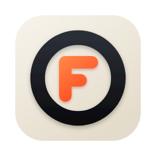
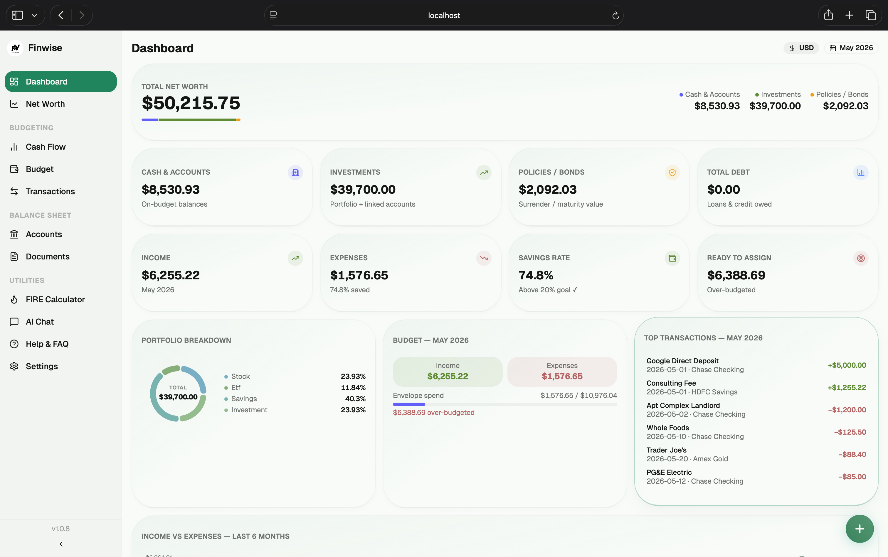
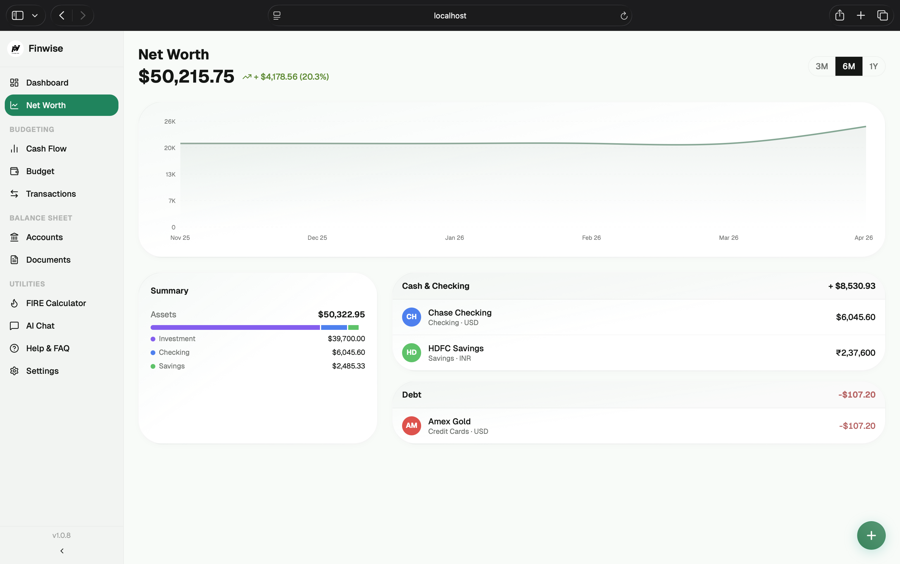
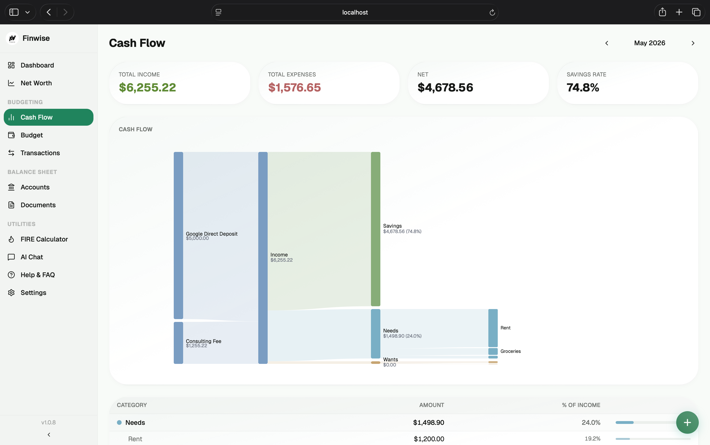
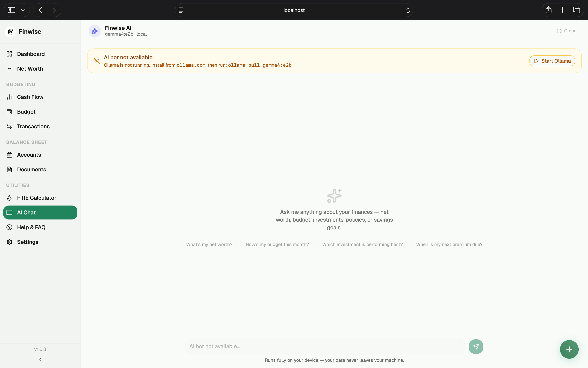
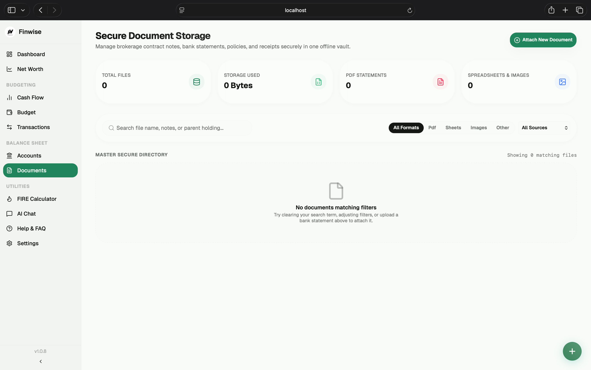
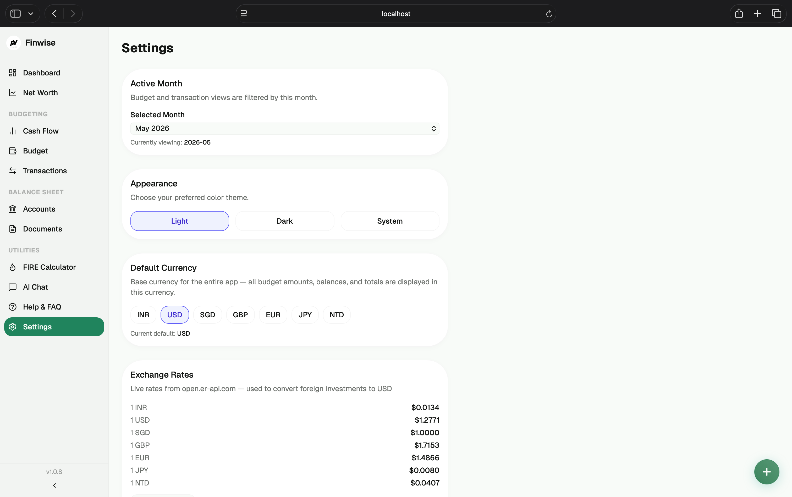

<div align="center">



# openFinance

### Your money. Your Mac. Nobody else's business.

A private, local-first finance app that budgets, tracks and answers questions about your money,<br>
without an account, a subscription or a single byte leaving your machine.


[**Features**](#features) · [**Install**](#install) · [**Your data**](#data) · [**AI**](#ai) · [**Contribute**](#contribute)

<br>



</div>

<br>

<a id="features"></a>

## ✨ What it does

<table>
<tr>
<td width="33%" valign="top">

### 🔐
**Locked by default**<br>
SQLCipher-encrypted database, unlocked by a passcode only you know. Documents and chats get their own AES-256 layer.

</td>
<td width="33%" valign="top">

### ✉️
**Envelope budgets**<br>
Zero-based budgeting where every dollar gets a job. Rollovers can carry forward, cap or reset.

</td>
<td width="33%" valign="top">

### 🏦
**Every account, one view**<br>
Checking, savings, cards, cash, loans, investments, physical assets and life insurance, rolled into net worth.

</td>
</tr>
<tr>
<td width="33%" valign="top">

### 🧠
**Offline AI**<br>
Ask *"what did I spend on coffee this month?"* A local Ollama model answers, with no cloud involved.

</td>
<td width="33%" valign="top">

### 💱
**Seven currencies**<br>
INR, USD, SGD, GBP, EUR, JPY and NTD, with live exchange rates and local formatting.

</td>
<td width="33%" valign="top">

### 📦
**One app, zero setup**<br>
No Docker, no server, no database to babysit. Drag to Applications and go.

</td>
</tr>
</table>

<details>
<summary><b>📸 Take the tour</b> (click to expand)</summary>
<br>

| | |
|:---:|:---:|
| <br>**Net worth** | <br>**Cash flow** |
| <br>**Envelope budget** | <br>**Transactions** |
| <br>**Investments** | <br>**Debt & loans** |
| <br>**Insurance** | <br>**AI assistant** |
| <br>**Document vault** | <br>**Settings & backups** |

</details>

<br>

<a id="install"></a>

## 🚀 Get it running

**1 · Grab the tools.** You need macOS, [Rust](https://rustup.rs), Node.js 22+ and pnpm 10+.

**2 · Build the app.**

```bash
./scripts/build-mac.sh
```

**3 · Install it.** Open the `.dmg` in `apps/desktop/src-tauri/target/release/bundle/dmg/` and drag **openFinance** into Applications.

**4 · First launch.** The app is unsigned, so right-click it, choose **Open**, then **Open** again. You only do this once.

> [!IMPORTANT]
> On first launch you'll set a **passcode**. It *is* your encryption key, and it's never stored anywhere, so a forgotten passcode can't be recovered. Write it down somewhere safe.

<br>

<a id="data"></a>

## 🗂️ Where your data lives

```
~/Library/Application Support/com.anindaghosh.openfinance/
├── 🔒 openfinance.db     encrypted database
├── 📄 uploads/           encrypted documents
└── 💬 chat-memories/     encrypted AI history
```

🕰️ Time Machine backs it up like any other folder.<br>
💾 For a portable copy, use **Settings → Backup & Restore → Export**. Backups from older versions import from the same screen.

<br>

<a id="ai"></a>

## 🤖 Ask your money anything

The assistant is optional. Install [Ollama](https://ollama.com), pull a model, and point **Settings → AI Assistant** at it (it defaults to `http://localhost:11434`):

```bash
ollama pull gemma4:e2b
```

It can run on this Mac, a GPU box on your LAN, or anywhere you can reach.

<br>

<a id="contribute"></a>

## 🛠️ Hack on it

```bash
pnpm install
pnpm --filter openfinance-desktop tauri dev     # app with hot reload
```

<details>
<summary><b>✅ Checks to run before a PR</b></summary>

```bash
pnpm build && pnpm test && pnpm lint
cd apps/desktop/src-tauri
cargo fmt --check
cargo clippy --workspace --all-targets -- -D warnings
cargo test --workspace
```

</details>

<details>
<summary><b>🧭 Find your way around</b></summary>
<br>

| | Path | What's inside |
|:--:|------|---------------|
| 🎨 | `apps/desktop/src` | React 19 UI, Vite and Tailwind 4 |
| 🪟 | `apps/desktop/src-tauri` | Tauri 2 shell: passcode gate and app lifecycle |
| ⚙️ | `apps/desktop/src-tauri/crates/openfinance-core` | Rust backend: API, encrypted DB, crypto and AI ([guide](apps/desktop/src-tauri/crates/openfinance-core/README.md)) |
| 🧩 | `packages/shared` | Schemas, API types and helpers used by the UI |
| 🔧 | `scripts` | Build and install scripts |

</details>

<br>

<div align="center">

📜 [Changelog](CHANGELOG.md)

<sub>Built with 🧡 for people who'd rather not hand their bank statements to a startup.</sub>

</div>
