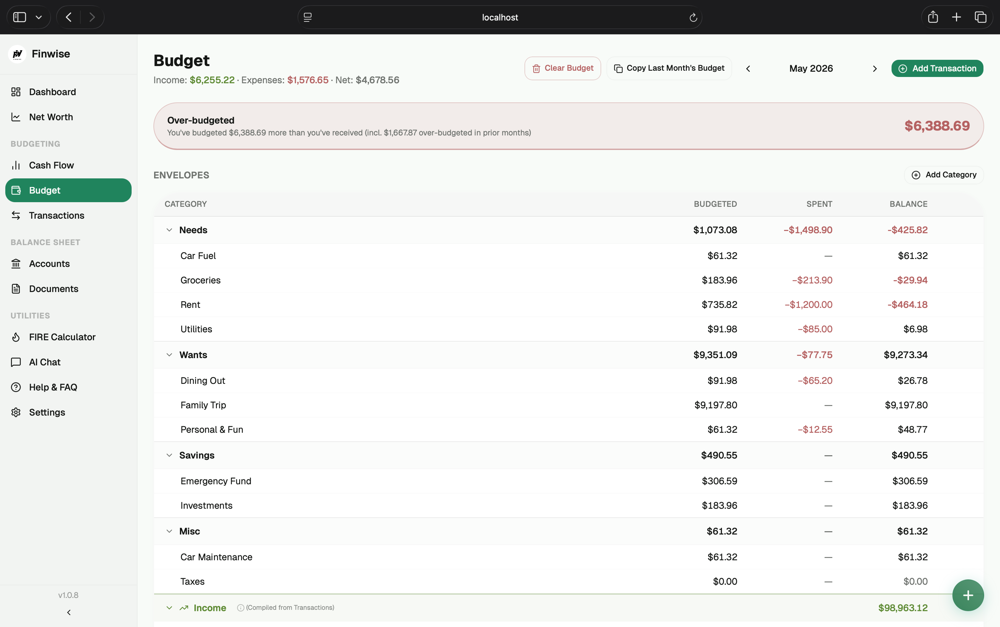
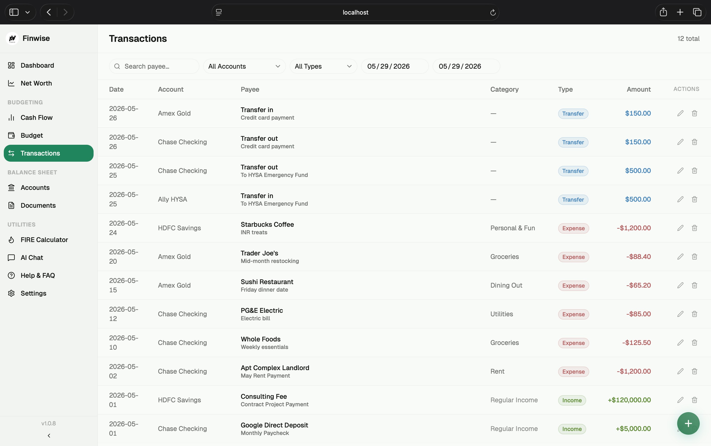
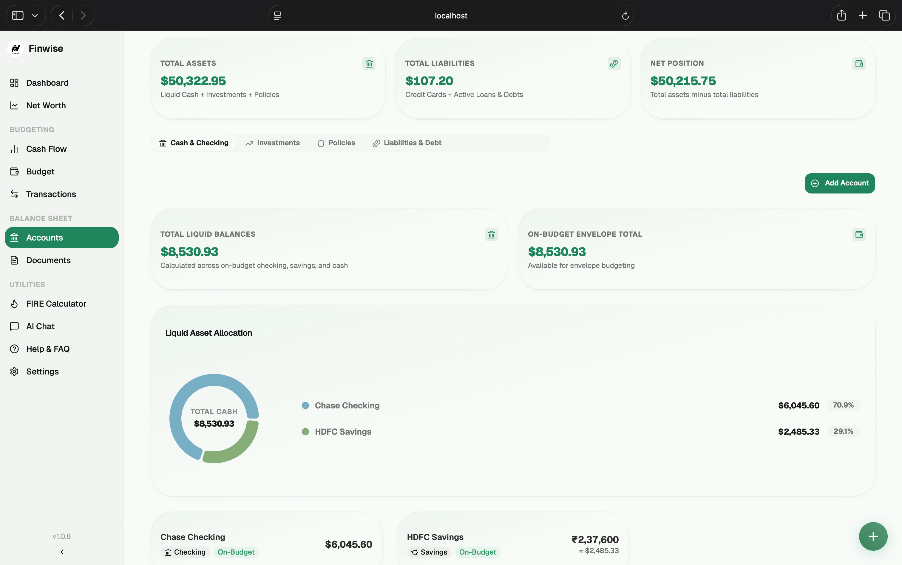
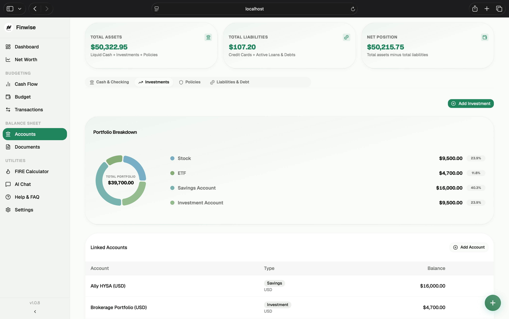
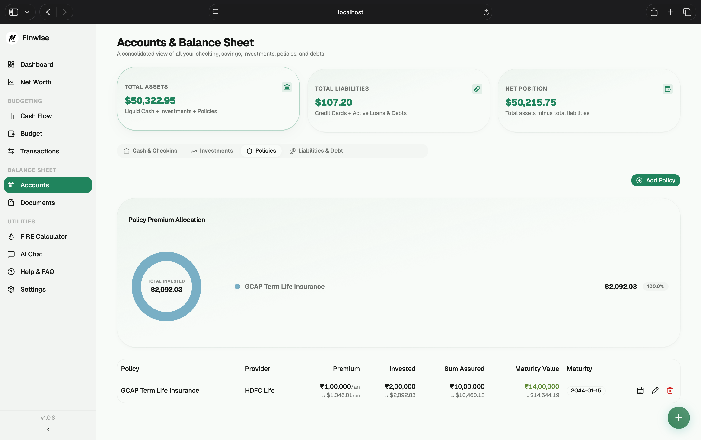
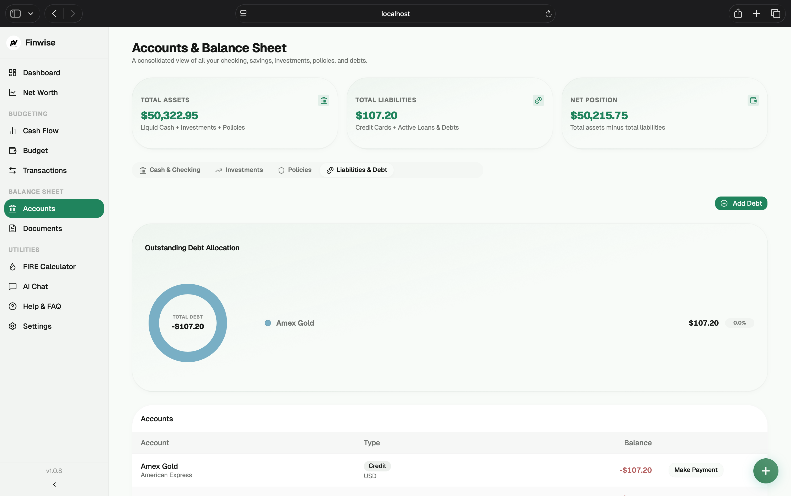
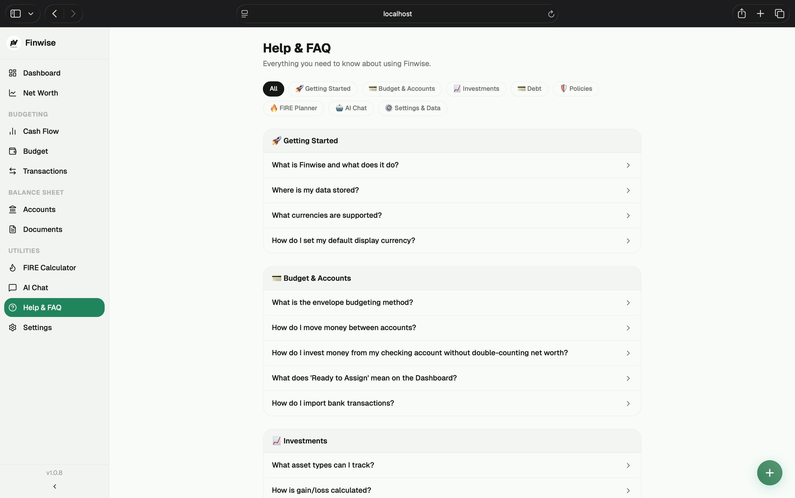

# 🦉 openFinance (v4.3.0) — Your Money. Your Rules. 💸

A local-first personal finance powerhouse built for developers, privacy purists, and builders who want **absolute control** over their financial destiny. No cloud trackers, no data brokers sniffing your transaction history, and no subscription fees. Just gorgeous Obsidian dashboards and secure offline AI chat, running 100% on your own hardware.

openFinance ships as a native macOS app you install from a `.dmg` like anything else. The whole stack — React UI, a Rust API server running inside the app process, and an SQLCipher-encrypted SQLite database — lives inside the one app bundle. No Docker, no database server, no network. One script (`./scripts/build-mac.sh`) builds the installer. 🚀

---

## ⚡ Superpowers

- 🛡️ **Local-First & Passcode-Protected** — Runs entirely on your own Mac. The database is unlocked with a passcode you set on first launch, and your data never leaves the machine.
- 🔒 **Encrypted at Rest, End to End** — The entire database is SQLCipher-encrypted with your passcode, and uploaded bank statements, contract notes, and AI chat memories get their own AES-256-GCM layer on disk. Lose the passcode and the file is just noise.
- 📦 **One-File Install** — Drag one app into Applications. The UI, the API server, and the database engine are all inside one binary; nothing else to install and nothing to keep running.
- 💸 **Envelope Budgeting** — Dynamic zero-based budgeting with custom rollovers (carry it forward, cap it, or reset it).
- 🏦 **Unified Balance Sheet** — Scannable tracking across Checking, Savings, Credit Cards, Cash, Investments, and Loans.
- 📈 **Tax-Loss & Portfolio Tracking** — Real-time performance metrics across mutual funds, stocks, bonds, high-yield deposits, real estate, and crypto.
- 🛟 **Life Insurance Register** — Who is covered, how much cover, when it renews, and the policy document itself — with renewal warnings ahead of the date. Cover is tracked for reference and deliberately kept out of your net worth, because a death benefit is not an asset you hold.
- 🧠 **100% Offline Local AI Chat** — Talk to your database! Ask natural-language questions like *"How much did I spend on Starbucks this month?"* powered by a local Ollama model. Your data never leaves your machine.
- 💱 **Global Multi-Currency Engine** — Native support for INR, USD, SGD, GBP, EUR, JPY, and NTD with dynamic exchange rates and localized formatting.
- 🌿 **Tactile Obsidian Theme** — A stunning, tactile user experience with rich layered depth, sage-green dark mode undertones, elegant brand gradients, and fluid transitions.
- 📦 **One-Click Backup & Import** — Decrypts files on export to a standard `.zip` folder and re-encrypts with your key when importing.

---

## Screenshots

### 1. Dashboard


### 2. Net Worth Analytics


### 3. Cash Flow Visualizer


### 4. Envelope Budgeting


### 5. Transactions Ledger


### 6. Checking & Savings Accounts


### 7. Investments & Holdings


### 8. Insurance Policies


### 9. Debt & Loans Tracker


### 10. Local AI Financial Assistant


### 11. Help & Documentation


### 12. Settings & Backups


### 13. Secure Document Storage


---

## Tech Stack

| Layer | Technology |
|-------|-----------|
| **Frontend** | React 19 + Vite + TypeScript + TailwindCSS 4 |
| **Backend** | Rust (axum + tokio), running inside the app process on `127.0.0.1:3001` |
| **Database** | SQLite (SQLCipher-encrypted, via rusqlite) |
| **AI LLM Client** | Ollama (local instance) |
| **App Shell** | Tauri 2 (Rust + WebKit) |
| **Packaging** | macOS `.dmg`, a single Tauri binary (no Node runtime) |

---

## Prerequisites

To **run** the app:
- **macOS** — nothing else. The installer carries everything it needs.

To **build the installer** or **modify the codebase**:
- **macOS** with Xcode command line tools (`xcode-select --install`)
- **Rust** — install from [rustup.rs](https://rustup.rs)
- **Node.js 22+** (builds the UI; the app does not ship it)
- **pnpm 10+**
- **Ollama** (optional, for AI chat features):
  ```bash
  ollama pull gemma4:e2b
  ```

---

## Building the Mac App

```bash
./scripts/build-mac.sh
```

That is the whole thing. The script installs the UI's dependencies and hands over to Tauri, which builds the UI with Vite and compiles the app together with its Rust API server and SQLCipher. Node is only needed at build time; the app does not ship it. The finished installer lands in `apps/desktop/src-tauri/target/release/bundle/dmg/`.

Open the `.dmg` and drag **openFinance** into Applications.

The build is unsigned, so macOS Gatekeeper stops the first launch. Get past it once and it never asks again:

- right-click the app in Applications → **Open** → **Open**, or
- `xattr -cr /Applications/openFinance.app`

### First launch

You are asked to **set a passcode**. That passcode is the database encryption key — it is not stored anywhere, so there is no reset. Write it down somewhere safe. Every later launch asks for it to unlock.

If you ever need to start over, the unlock screen has a **Reset App / Wipe Database** link.

### Where your data lives

```
~/Library/Application Support/com.anindaghosh.openfinance/
├── openfinance.db      # SQLCipher-encrypted database
├── uploads/            # Documents, AES-256-GCM encrypted
└── chat-memories/      # AI conversation memories, encrypted
```

Time Machine picks this up like any other folder. For a portable copy, use **Settings → Backup & Restore → Export** — it writes a single encrypted `.ofb` file.

---

## Migrating From an Older Install

Backups (`.ofb`) exported by any earlier openFinance version — including the old self-hosted Docker/PostgreSQL stack — import into the Mac app through **Settings → Backup & Restore**. (From the old stack, export while it is still running: the export decrypts your documents with that deployment's `ENCRYPTION_KEY`.) If the backup was made by a different install, the app asks for the **username and password** used there. Everything transfers, including uploaded documents, which are re-encrypted under your passcode on the way in.

> ⚠️ **Import replaces all existing data** in the Mac app. Do it before you start entering anything by hand.

Backups from the even older **Finwise** app (`.fwb`) can be converted first: `node scripts/convert-backup.mjs <path-to-backup.fwb>` asks for the old Finwise username and password and writes an unencrypted ZIP the app imports directly.

---

## Local Development

```bash
# 1. Install the UI's dependencies
pnpm install

# 2. Run the app with the Tauri shell and hot reload
pnpm --filter openfinance-desktop tauri dev
```

The Tauri window opens on the passcode screen and, on unlock, starts the Rust API server inside the app process, against the database in the app's data directory (the same one the installed app uses). `pnpm dev` alone starts only the Vite dev server for the UI; it has no backend.

Checks:

```bash
pnpm build                     # type-check (tsc) and build the UI (vite)
pnpm test                      # UI unit tests (vitest)
pnpm lint                      # biome
cd apps/desktop/src-tauri
cargo fmt --check
cargo clippy --workspace --all-targets -- -D warnings
cargo test --workspace         # backend + app lifecycle tests
```

The backend crate has its own guide: [`apps/desktop/src-tauri/crates/openfinance-core/README.md`](apps/desktop/src-tauri/crates/openfinance-core/README.md).

### AI assistant (Ollama)

The AI chat connects to any reachable [Ollama](https://ollama.com) server — configure the URL and model from the in-app **Settings → AI Assistant** page (defaults to `http://localhost:11434`). Nothing is hardcoded: point it at your Mac, a GPU box on your LAN, or anywhere else.

---

## Project Structure

```
openFinance/
├── apps/
│   └── desktop/                  # The Mac app
│       ├── src/                  # React UI (Vite, TailwindCSS)
│       └── src-tauri/            # Tauri app: passcode gate, backend lifecycle (src/)
│           └── crates/
│               └── openfinance-core/   # Rust API server, SQLCipher DB, crypto, AI chat
│
├── packages/
│   └── shared/                   # Shared API types, constants and helpers used by the UI
│
├── docs/rust-port/               # Known ported bugs (QUIRKS.md), manual acceptance checklist
├── screenshots/                  # README previews
├── scripts/
│   ├── build-mac.sh              # Builds the macOS app and .dmg installer
│   └── convert-backup.mjs        # Decrypts legacy Finwise backups
├── package.json                  # Workspace root package config
└── pnpm-workspace.yaml           # pnpm workspace configuration
```

---

## Changelog

See [CHANGELOG.md](./CHANGELOG.md) for full project releases and commit histories.
